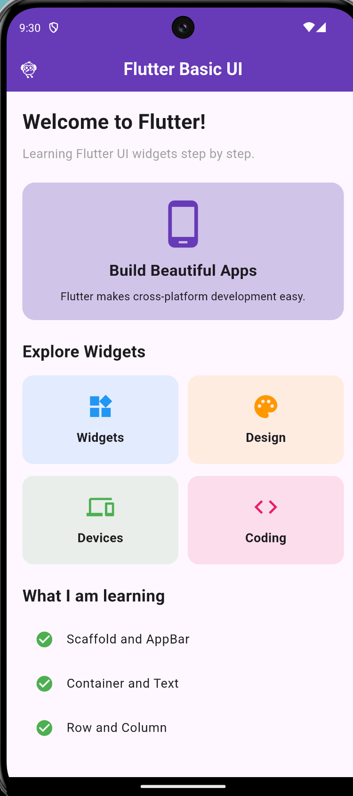
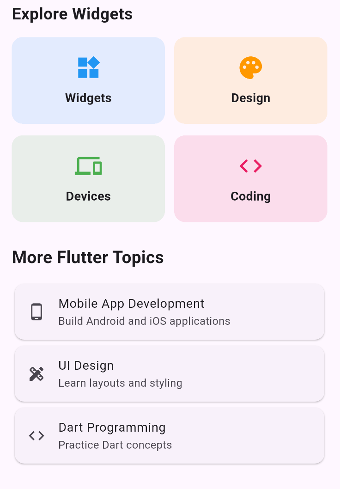

# Basic UI – Part 1 

## Objective
Create a responsive Flutter screen using fundamental Flutter UI widgets.

## Widgets Used
- Scaffold
- AppBar
- Text
- Container
- Row
- Column
- Icon
- ListTile
- SingleChildScrollView

## Features
- Custom AppBar
- Welcome screen
- Styled containers and feature cards
- Icons and text
- Row and Column layouts
- Responsive and scrollable UI
- Proper padding and alignment

## Run Application

```bash
cd basic_ui_app
flutter pub get
flutter run
```

## Screenshots

### Home Screen


### Row and Column


### Scrollable Layout


## Result
Successfully created a responsive Flutter screen using basic UI widgets and Material Design 3.

**Technology:** Flutter and Dart