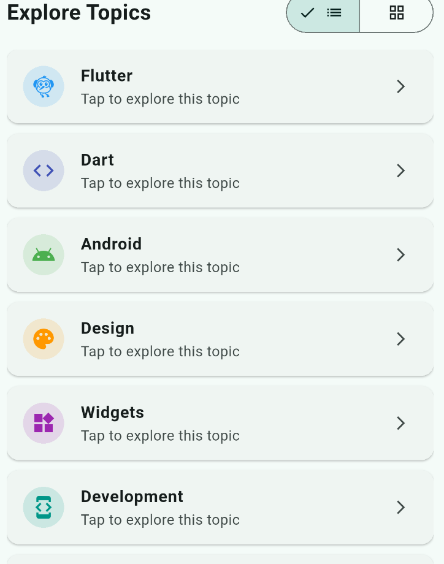
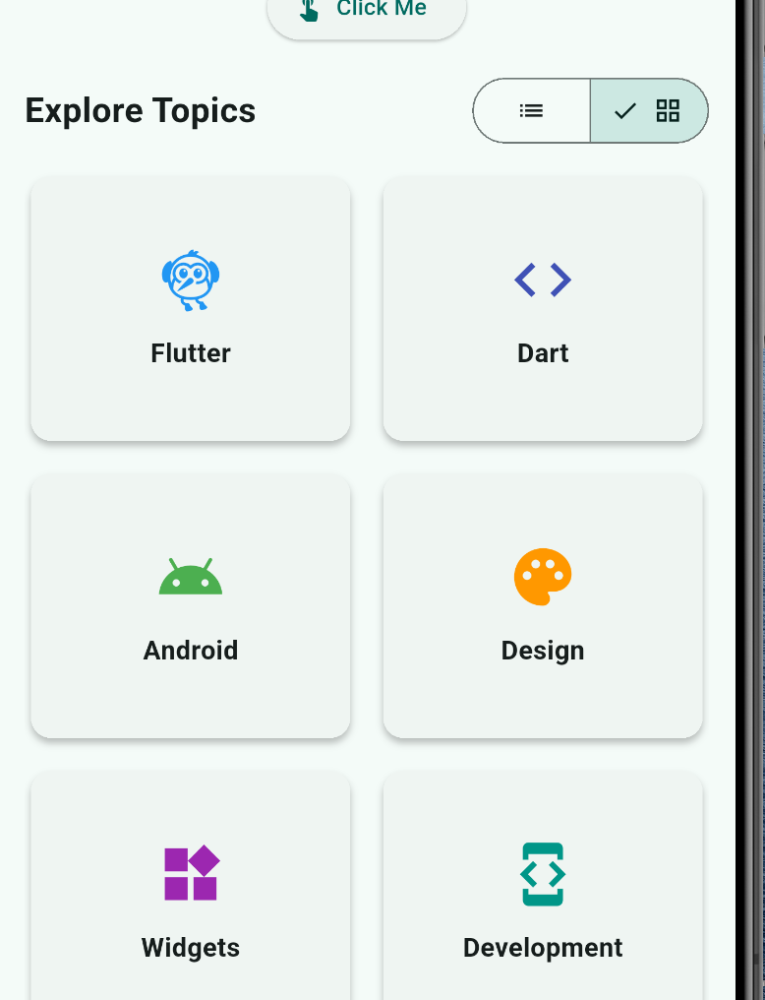
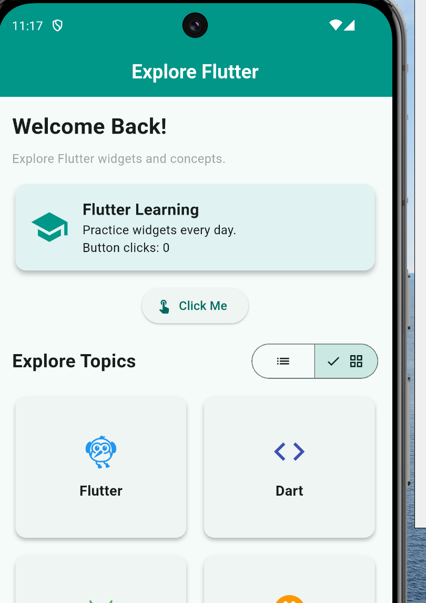

# Basic UI – Part 2 

## Objective
Extend Flutter UI development using advanced widgets and implement user interactions.

## Widgets Used
- ListView
- GridView
- Card
- ListTile
- ElevatedButton
- SegmentedButton
- InkWell
- SnackBar

## Features
- Scrollable ListView
- Two-column GridView
- Cards with icons
- List and Grid view switching
- Interactive button counter
- Item tap handling
- SnackBar messages
- Proper spacing and theming

## Run Application

```bash
cd basic_ui_advanced_app
flutter pub get
flutter run
```

## Screenshots

### List View


### Grid View


### User Interaction


## Result
Successfully implemented advanced Flutter UI widgets with interactive functionality.

**Technology:** Flutter and Dart