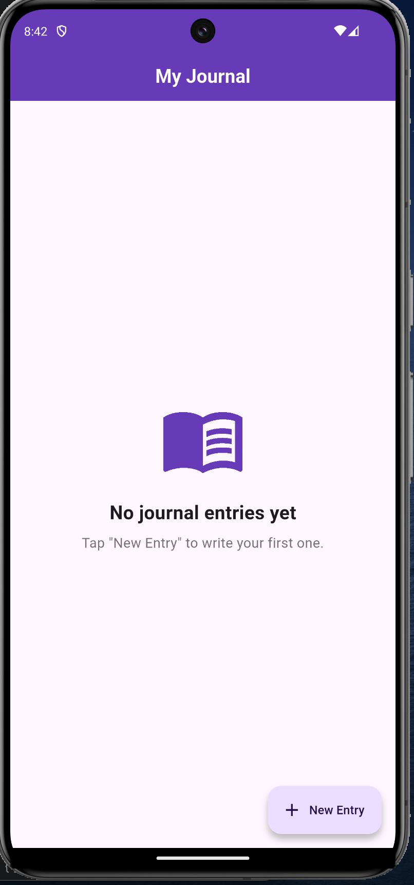
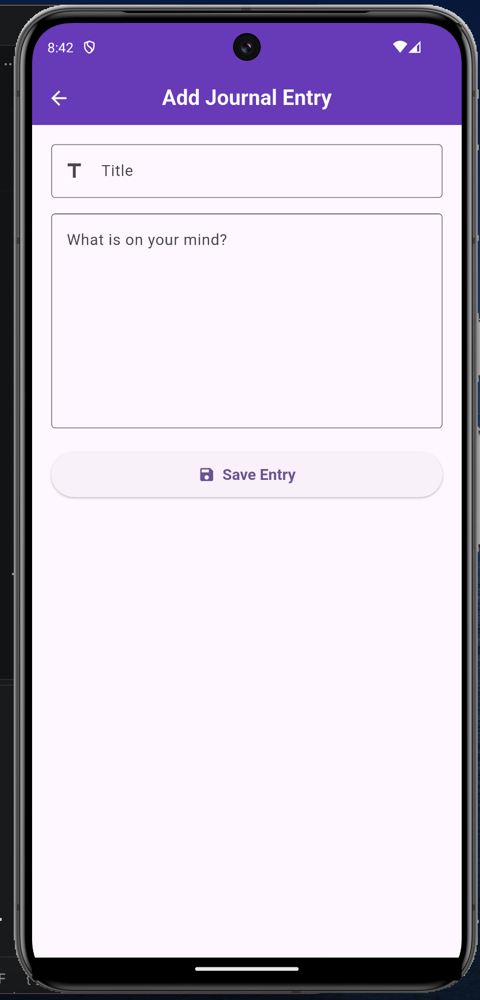
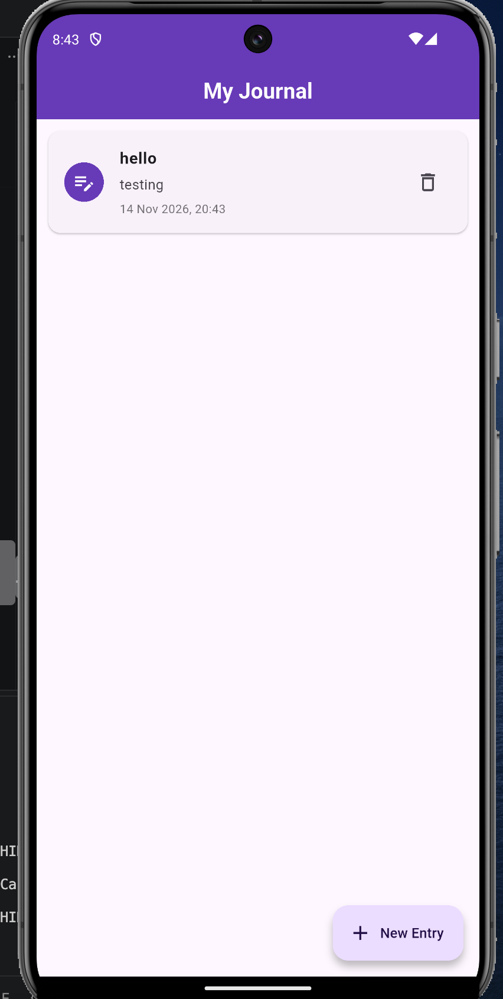
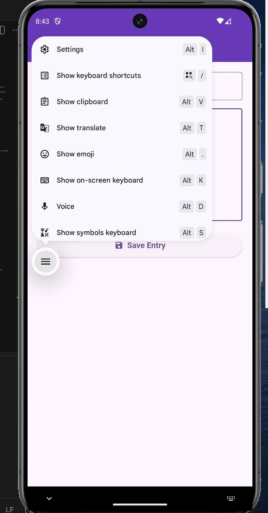

# Journal App 📔

## Objective
Build a Journal App in Flutter where the user can add journal entries, see them in a list, and open an entry to read its full details.

## Requirements
- Create a new Flutter project.
- Show an empty state when there are no entries.
- Add a journal entry with a title and content.
- Validate the form before saving.
- Display all entries in a list.
- Open an entry to view its details.
- Delete an entry.
- Run on Android Emulator.

## Widgets Used
- MaterialApp
- Scaffold
- AppBar
- StatefulWidget
- ListView.builder
- Card
- ListTile
- Form
- TextFormField
- ElevatedButton
- FloatingActionButton
- SnackBar
- Navigator

## Concepts Used
- StatefulWidget and setState
- Model class (`JournalEntry`)
- Form validation with `GlobalKey<FormState>`
- TextEditingController
- Navigation between screens and returning data with `Navigator.pop`

## Commands

```bash
flutter create journal_app
cd journal_app
flutter pub get
flutter analyze
flutter run
```

## Screenshots

### Empty Journal


### Add Journal Entry


### Journal Entry List


### Journal Entry Details


## Result
Successfully built a Journal App that lets the user add, view, and delete journal entries.

**Technology:** Flutter and Dart
