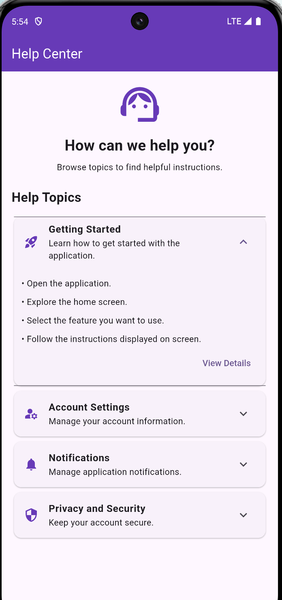

# Help & Instruction App 📖

## Objective
Build a Help and Instruction app in Flutter with a help home screen, an expandable list of help topics, and a details screen that shows step-by-step instructions.

## Requirements
- Create a new Flutter project.
- Show a help home screen.
- List help topics that expand to show quick instructions.
- Open a topic to read its step-by-step details.
- Navigate between screens.
- Run on Android Emulator.

## Widgets Used
- MaterialApp
- Scaffold
- AppBar
- Column
- ListView
- Card
- ExpansionTile
- ListTile
- TextButton
- Icon
- Navigator

## Concepts Used
- Model class (`HelpTopic`)
- Expandable list items
- Passing data to another screen

## Commands

```bash
flutter create help_instruction_app
cd help_instruction_app
flutter pub get
flutter analyze
flutter run
```

## Screenshots

### Help Home


### Help Topics


### Help Details


## Result
Successfully built a Help and Instruction app with expandable topics and step-by-step guides.

**Technology:** Flutter and Dart
