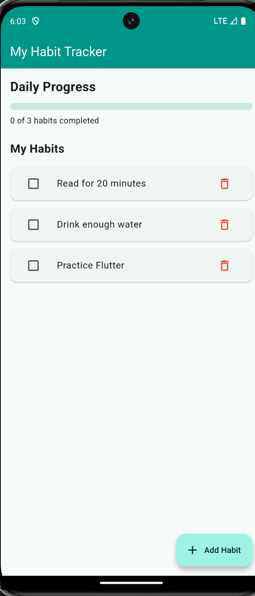
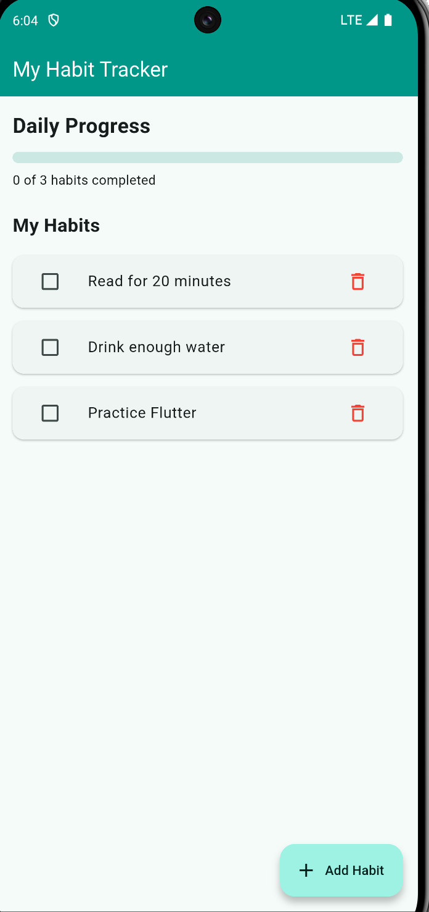

# Creative Application – Daily Habit Tracker ✅

## Objective
Build a Daily Habit Tracker in Flutter that manages its state with Provider and ChangeNotifier, so the progress updates as soon as a habit changes.

## Features
- Add habits.
- Mark habits as completed.
- Update progress dynamically.
- Delete habits.
- Use Provider and ChangeNotifier.

## Project Structure

```
lib/
├── main.dart
├── models/
│   └── habit.dart
├── providers/
│   └── habit_provider.dart
├── screens/
│   └── home_screen.dart
└── widgets/
    └── habit_card.dart
```

## Widgets Used
- ChangeNotifierProvider
- MaterialApp
- Scaffold
- AppBar
- Column
- ListView.builder
- Card
- ListTile
- Checkbox
- LinearProgressIndicator
- AlertDialog
- TextField
- FloatingActionButton

## Concepts Used
- Provider package
- ChangeNotifier and notifyListeners
- `context.watch` and `context.read`
- Model class (`Habit`)

## Commands

```bash
flutter create creative_app
cd creative_app
flutter pub add provider
flutter pub get
flutter analyze
flutter run
```

## Screenshots

### Creative Home


### State Update


### Tracker


## Result
Successfully built a Daily Habit Tracker where adding, completing and deleting habits updates the progress through Provider.

**Technology:** Flutter, Dart and Provider
