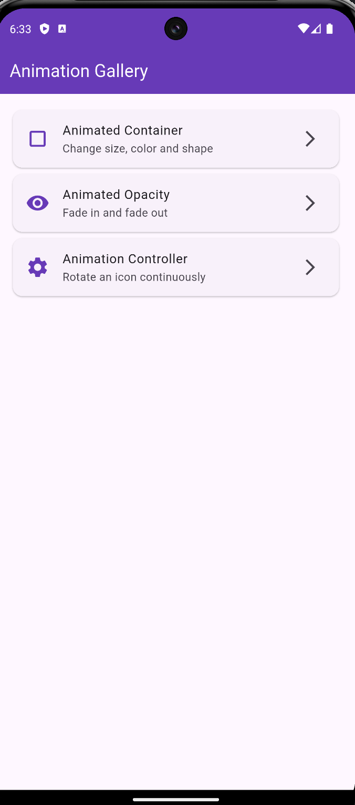
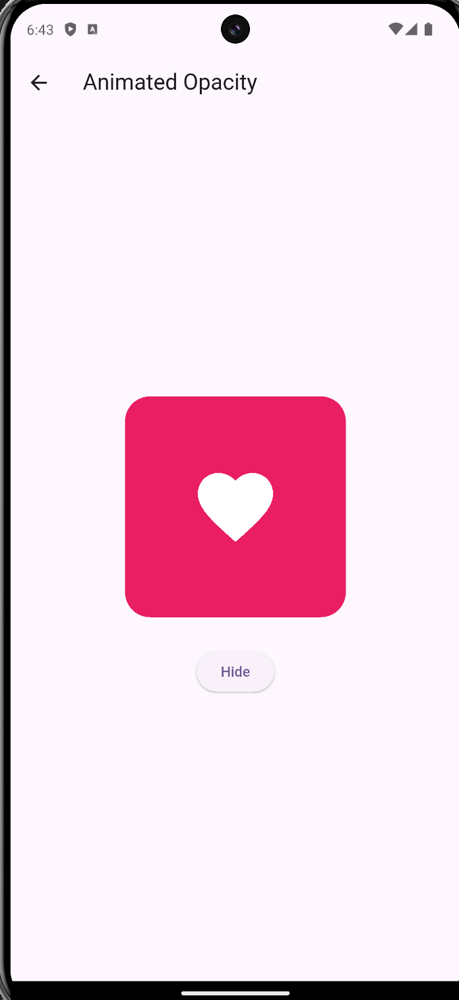
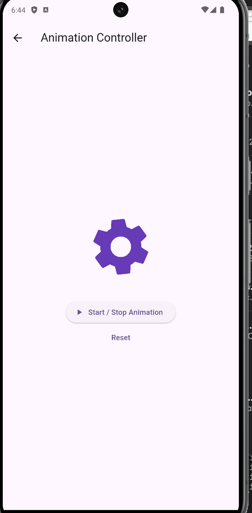

# Animation Screens App ✨

## Objective
Build a Flutter app with three screens that each demonstrate a different animation technique.

## Requirements
- Create a new Flutter project.
- Show an animation gallery on the home screen.
- Animate size, color and shape with AnimatedContainer.
- Fade a widget in and out with AnimatedOpacity.
- Rotate an icon continuously with AnimationController.
- Run on Android Emulator.

## Project Structure

```
lib/
├── main.dart
└── screens/
    ├── animated_container_screen.dart
    ├── animated_opacity_screen.dart
    └── animation_controller_screen.dart
```

## Widgets Used
- AnimatedContainer
- AnimatedOpacity
- AnimationController
- AnimatedBuilder
- Tween
- Transform.rotate
- ListView.builder
- Card
- ListTile
- ElevatedButton
- TextButton

## Concepts Used
- Implicit animations (AnimatedContainer, AnimatedOpacity)
- Explicit animations (AnimationController)
- SingleTickerProviderStateMixin
- Disposing the controller
- Navigation between screens

## Commands

```bash
flutter create animation_app
cd animation_app
flutter pub get
flutter analyze
flutter run
```

## Screenshots

### Animated Container


### Animated Opacity


### Animation Controller


## Result
Successfully built an animation gallery that shows implicit and explicit animations on separate screens.

**Technology:** Flutter and Dart
