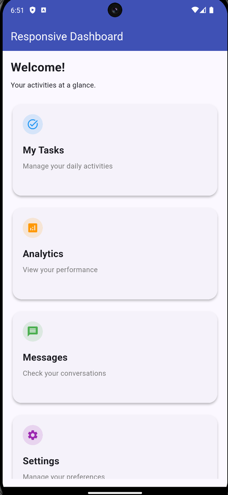

# Responsive & Adaptive App 📱💻

## Objective
Build a responsive dashboard in Flutter that adapts its layout to mobile, tablet and desktop screens.

## Requirements
- Create a new Flutter project.
- Organise the code into screens and widgets.
- Use LayoutBuilder to read the available width.
- Change the number of columns, padding and heading for each screen size.
- Run on mobile, tablet and desktop sizes.

## Layouts

| Screen  | Width          | Columns | Heading                   |
|---------|----------------|---------|---------------------------|
| Mobile  | below 600 px   | 1       | Welcome!                  |
| Tablet  | 600 to 999 px  | 2       | Welcome to Your Dashboard |
| Desktop | 1000 px and up | 3       | Welcome to Your Dashboard |

## Project Structure

```
lib/
├── main.dart
├── screens/
│   └── dashboard_screen.dart
└── widgets/
    └── dashboard_card.dart
```

## Widgets Used
- LayoutBuilder
- Scaffold
- AppBar
- GridView.builder
- Card
- CircleAvatar
- Column
- Padding
- Text
- Icon

## Concepts Used
- Breakpoints for mobile, tablet and desktop
- Responsive grid with a changing column count
- Reusable widget (`DashboardCard`)

## Commands

```bash
flutter create responsive_app
cd responsive_app
flutter pub get
flutter analyze
flutter run              # mobile (Android Emulator)
flutter run -d chrome    # resize the window for tablet and desktop
flutter run -d macos     # desktop
```

## Screenshots

### Mobile Layout


### Tablet Layout


### Desktop Layout


## Result
Successfully built a responsive dashboard that changes its layout for mobile, tablet and desktop screens.

**Technology:** Flutter and Dart
